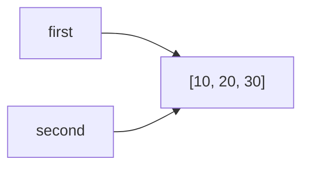
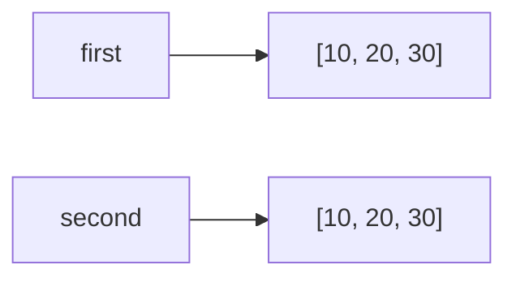
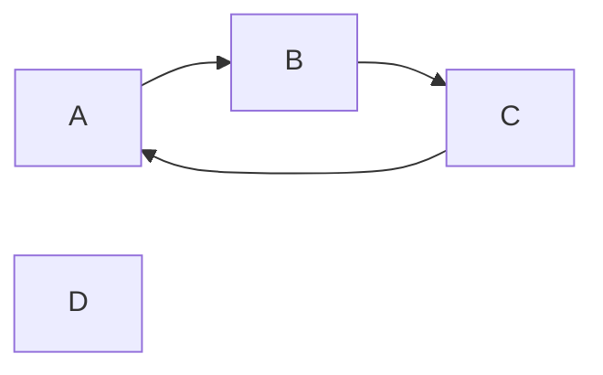

# Задание 1

### Эксперимент А 

Причина в том, что int в Python неизменяем, и a += 1 - это фактически a = a + 1, то есть создание нового объекта и перепривязка только имени a, b продолжает ссылаться на тот же объект памяти Python.

### Эксперимент В

** До переназначения** (`second = first`):

**После переназначения** (`second = [10, 20, 30]`):

### Вопросы для анализа:
#### 1. Меняет ли присваивание second = first сам объект?

Нет, присваивание "=" работает с именами, а не с объектами. Оно лишь привязывает имя second к тому же объекту, на который уже указывает first.

#### 2. Почему операция над неизменяемым объектом приводит к связыванию имени с другим объектом?

Потому что неизменяемый объект нельзя изменить. Поэтому операция не меняет старый объект, а создаёт новый, и имя начинает указывать на него. Старый объект остаётся прежним и доступен через другие имена, которые на него ссылаются.

#### 3.Как определить, что два имени обозначают один объект?

С помощью оператора is — он возвращает True, если оба имени указывают на один и тот же объект. То же самое можно проверить через id(): если id(a) == id(b), значит это один объект.

# Задание 2

| Операция | Новый внешний объект | Новые вложенные объекты | Изменения независимы |
|---|---|---|---|
| Присваивание | Нет | Нет | Нет |
| Поверхностная копия | Да | Нет | Частично |
| Глубокая копия | Да | Да | Да |

### Вопросы для анализа:

#### 1. Чем поверхностная копия отличается от глубокой?
   
Поверхностная копия создаёт новый внешний объект, но вложенные объекты остаются общими с оригиналом. Глубокая копия копирует и внешний объект, и все вложенные, поэтому изменения в копии никак не отражаются на оригинале.

#### 2. Почему глубокое копирование не следует применять автоматически ко всем объектам?

deepcopy() рекурсивно обходит весь граф объектов, что дорого по памяти и времени, а также может «сломать» логику, если объект ссылается на разделяемые ресурсы

#### 3. В каких случаях достаточно поверхностной копии?

Поверхностной копии достаточно, когда вложенные объекты неизменяемы, когда вложенные данные должны намеренно разделяться между структурами, или когда после копирования вложенные элементы только читаются и не модифицируются.

# Задание 3

* "sys.getrefcount()" показывает на одну временную ссылку больше, потому что объект передаётся в саму функцию как аргумент. В момент выполнения sys.getrefcount(data) интерпретатор создаёт дополнительную ссылку на объект - она живёт в параметре функции, пока она работает.

* Счётчик увеличивают любые инструкции, которые создают новую ссылку на объект: присваивание имени, помещение в контейнер, присваивание атрибуту, передача объекта в функцию, возврат объекта из функции.

* Счётчик уменьшают любые инструкции, при которых сильная ссылка исчезает: удаление имени, переприсваивание имени, очистка контейнера, удаление элемента, удаление контейнера, выход имени из области видимости. 

* del alias удаляет имя, а не командует напрямую удалить объект, потому что имя и объект в Python - это разные сущности. Имя - это запись в пространстве имён, то есть просто ключ, значением которого является ссылка на объект. Объект - это область памяти в куче, которой владеет интерпретатор.

* Слабая ссылка не продлевает время жизни объекта, потому что weakref.ref(obj) создаёт объект-наблюдатель. Слабая ссылка только регистрируется у объекта в списке наблюдателей. Когда все сильные ссылки исчезают, объект уничтожается, а слабая ссылка автоматически становится None. 

### Вопросы для анализа:

#### 1.При каком условии подсчет ссылок позволяет освободить объект?

Подсчёт ссылок позволяет освободить объект, когда счётчик сильных ссылок становится равен нулю и объект не участвует в циклической структуре. 

#### 2.Всегда ли освобождение Python-объекта означает немедленный возврат памяти операционной системе?

Освобождение Python-объекта не всегда означает немедленный возврат памяти операционной системе, потому что CPython использует собственный аллокатор (pymalloc) с пулами и аренами памяти.

#### 3.Чем сильная ссылка отличается от слабой?

Сильная ссылка отличается от слабой тем, что сильная увеличивает счётчик ссылок объекта и удерживает его от уничтожения, а слабая — не увеличивает счётчик и не препятствует уничтожению. 
  
# Задания 4

#### Почему одного подсчета ссылок недостаточно для удаления созданного цикла?

Простого подсчёта ссылок недостаточно для удаления созданного цикла, ведь при удалении имён обьекты ссылаются друг на друга, сохраняя одну ссылку, это препятствует их удалению.

#### Назначение поколений сборщика мусора без привязки к конкретным значениям порогов?

Поколение 0 — самые молодые объекты.

Поколение 1 — объекты, пережившие одну сборку.

Поколение 2 — объекты, пережившие несколько сборок.

### Вопросы для анализа:

#### 1. Как возникает циклическая ссылка?

Циклическая ссылка появляется, когда два или более объекта ссылаются друг на друга, замыкая кольцо.

#### 2. Почему объект с ненулевым счетчиком ссылок иногда может быть недостижим из программы?

Счётчик ссылок показывает, сколько других объектов на тебя ссылаются, но не показывает, может ли программа до тебя добраться.

#### 3. Зачем сборщик мусора разделяет отслеживаемые объекты по поколениям?

Полный обход всех объектов для поиска циклов - дорогая операция. Если делать её часто, программа будет тормозить. Если редко - память будет забиваться мусором. Нужно проверять часто там, где мусора много, и редко — там, где его почти нет.

# Задание 5

## Часть 1

Размер контейнера включает размер самой структуры и размер массива ссылок.

## Часть 2

#### Увеличивается ли размер списка после каждого append()?

Размер списка не увеличивается после каждого append()

#### Почему список резервирует место с запасом?

Нельзя перевыделять память при каждом append() - это было бы O(n) на каждое добавление и дало бы O(n^2) на n добавлений.

#### Чем длина списка отличается от объёма выделенной памяти?

#### Длинна списка - количество элементов, объём выделенной памяти - сколько слотов с запасом зарезервировано под элементы.
 
## Часть 3

#### Различие между материализованной последовательностью и объектом, который хранит правило получения значений:

При одинаковом логическом содержимом range экономит память в десятки тысяч раз, но уступает в возможностях - нельзя изменить, повторно обойти уже пройденное или получить произвольный элемент без пересчёта.

### Итоговый анализ:

Для того, чтобы уменьшить потребление памяти, можно:

1. Использовать ленивые последовательности, например range(100_000) вместо list(range(100_000))

2. Создавать список сразу нужного размера: [0] * n вместо цикла с append, ведь он выделяет больше слотов, чем нужно сейчас.

3. Хранить однотипные данные компактно: array вместо list объектов

# Вывод:

Наиболее опасные ошибки при работе с изменяемыми объектами - два имени указывают на один объект, изменяемые аргументы по умолчанию, поверхностное копирование вложенных структур и мутация контейнера во время итерации: все они приводят к незаметной порче данных и утечкам памяти
